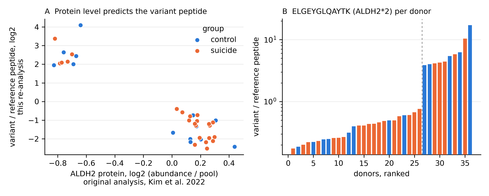
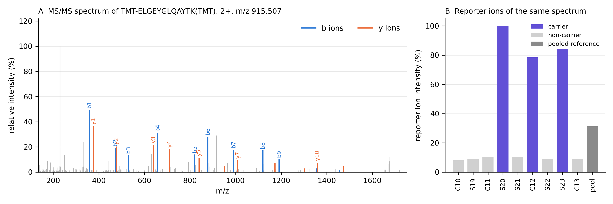
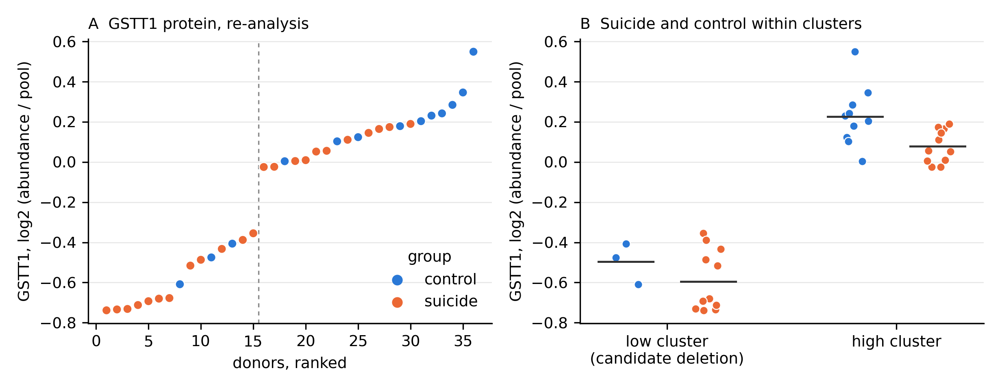
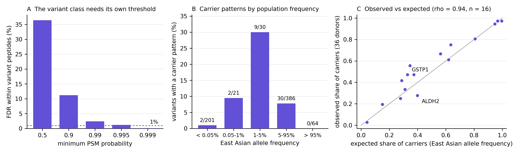
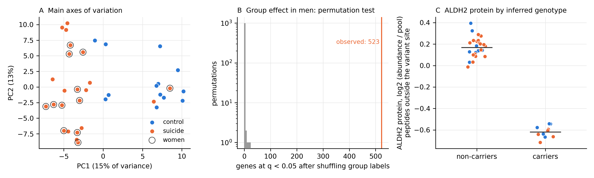
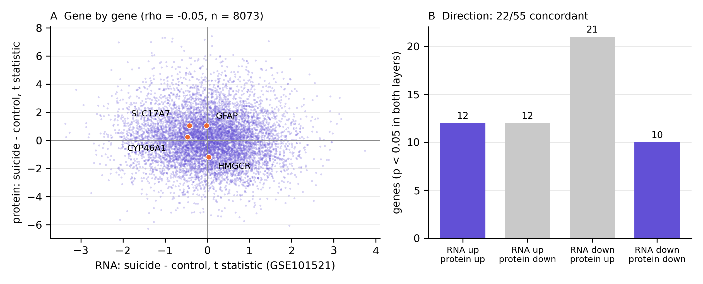
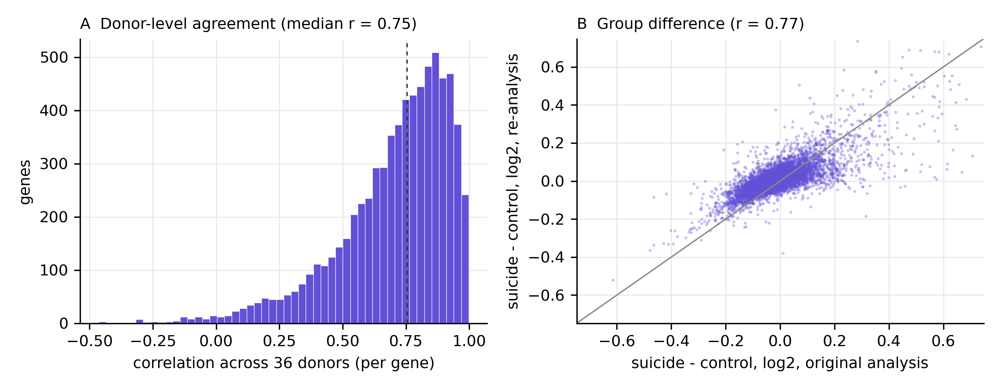

# Reading donor genotypes from a public brain proteome

Open re-analysis of the post-mortem prefrontal cortex proteome of suicide decedents and controls (Kim et al. 2022, PRIDE **PXD029845**), from raw spectra to figures.

## Background

Post-mortem proteomic studies of suicide rely on small cohorts. In such cohorts, germline variation that changes the abundance or the sequence of a protein is unlikely to be balanced between groups, and an inherited difference can be mistaken for a disease-related change. Genotype data are rarely available for brain-bank cohorts, so this source of confounding usually remains unexamined.

## Aims

This repository re-analyses a public TMT dataset from the raw spectra and addresses two questions:

1. Can common germline coding variants be assigned to individual donors from a bulk brain proteome, with error control specific to variant peptides?
2. How much of the reported suicide vs control difference in GSTT1, proposed as a candidate marker, is accounted for by the common *GSTT1* gene deletion?

## Main results

**ALDH2\*2 (rs671) carriers identified from the proteome, two independent ways.**
Protein abundance alone predicted 10 carriers among 36 donors. A variant-aware re-search of the raw spectra then identified the variant-specific peptide in all four TMT sets; its reporter ions single out the same 10 donors, with no overlap with the other 26. Carrier status is unrelated to group (5/23 suicide, 5/13 control).



The variant peptide is identified with a complete b- and y-ion series, and the reporter ions of a single spectrum already point to the carriers of that TMT set.



**GSTT1.** Abundance is bimodal and all GSTT1 peptides shift together, as expected for the common gene deletion. The cluster explains 87% of the variance between donors and 60% of the reported suicide vs control difference.



**Proteome-wide, a carrier pattern separates inherited variants from artefacts.**
With a class-specific FDR for variant peptides and a threshold calibrated on ordinary peptides, the share of carriers among the 36 donors matches the value expected from East Asian allele frequencies (Spearman rho = 0.94 for the 16 variants quantified in all TMT sets). Variant peptides of alleles that are absent from East Asian populations are detected too, but show no carrier pattern: detection alone is not a genotype.



**Inferred genotype has a protein-level consequence.**
Carriers of ALDH2\*2 have a markedly lower ALDH2 level on peptides that do not contain the variant site (a cis protein-QTL test with genotypes read from the proteome). The same notebook models the group difference with sex and TMT set and tests it by permutation.



**RNA and protein do not tell the same story across cohorts.**
Gene by gene, the suicide-control difference at the protein level (this re-analysis) is unrelated to the difference at the RNA level in an independent RNA-seq study of the same region (GSE101521): Spearman rho about -0.05 over 8,073 genes, and genes significant in both layers agree in direction no more often than chance.



**The re-analysis reproduces the original one.** 93% of the genes of the original analysis are recovered; donor-level quantities agree (median per-gene correlation 0.75).



## Data

| | |
|---|---|
| Dataset | Kim MJ et al. *Transl Psychiatry* 12:142 (2022), doi:10.1038/s41398-022-01896-z; PRIDE PXD029845 |
| Samples | prefrontal cortex (BA9/10); 23 suicide decedents, 13 sudden-death controls |
| Design | 4 × TMT 10-plex, 24 high-pH fractions each, Q-Exactive, MS2 quantification; channel 131N = pooled reference |
| Raw files | 96 files, 200 GB, verified against PRIDE SHA-1 checksums |

## Workflow

| Notebook | Step |
|---|---|
| `00_environment_check` | hardware and software report |
| `01_download_raw_data` | download with resume, SHA-1 verification, one folder per TMT set |
| `02_authors_table_sample_map_and_genotype_like_proteins` | TMT set, channel and sex of every sample recovered from the published tables; proteome-wide scan for two-cluster proteins |
| `03_variant_aware_sequence_database` | Swiss-Prot human + 84,003 curated single amino-acid variants (UniProt humsavar) + contaminants + decoys |
| `04_fragpipe_search_setup` | channel annotation, FragPipe workflow, manifests, launchers |
| `05_quality_control_vs_original_analysis` | identifications and donor-level agreement with the original analysis |
| `06_ALDH2_variant_peptide_confirmation` | ALDH2\*2 carriers from reporter ions of the variant peptide |
| `07_GSTT1_deletion_vs_reported_marker` | GSTT1 bimodality, peptide-level consistency, group comparison |
| `08_variant_peptides_proteome_wide` | class-specific FDR, mass ambiguity, carrier patterns against an empirical null, comparison with population allele frequencies, cytochrome panel |
| `09_models_with_covariates_and_inferred_genotype` | principal components, group comparison with sex and TMT set, permutation test, protein level by inferred genotype |
| `10_rna_vs_protein` | protein-level differences against RNA-level differences from an independent RNA-seq cohort (GSE101521) |

Search: FragPipe 24.0 (MSFragger 4.4.1, MSBooster, Percolator, Philosopher 5.1.3, IonQuant 1.11.20, TMT-Integrator 6.1.3), stock `TMT10` workflow with the database of notebook 03 and the pooled channel as reference. Settings: `config/MOSAIC_TMT10_variants.workflow`.

## Reproduce

```
conda env create -f environment.yml      # or: pip install -r requirements.txt
conda activate mosaic-reanalysis
jupyter lab                      # run notebooks 00-04
RUN_SEARCH_ALL_SETS.bat          # FragPipe, headless (Windows)
jupyter lab                      # run notebooks 05-10
```

- **Versions.** Package versions are pinned in `environment.yml` and `requirements.txt`; all software versions, including the FragPipe tools, are listed in `results/software_versions.tsv`.
- **Database.** Built from UniProt release 2026_04 (Swiss-Prot FASTA and `humsavar`). UniProt serves only its current release at the download addresses, so a later run of notebook 03 gives a slightly different database. The FASTA used here is identified by its SHA-1 in `results/database_summary.tsv`; rebuilding it from the same release reproduces that checksum.
- **Locations.** Notebooks find the project folder themselves. The FragPipe folder is taken from the environment variable `FRAGPIPE_HOME` (default `C:\FragPipe\FragPipe-24.0`). Paths with spaces break some FragPipe tools.
- **Where things ran.** The search ran on a Windows desktop (Intel i5-13500, 32 GB RAM): 2 h 26 min for all 96 files plus 28 min for quantification. The notebooks were developed and first executed on Linux (Python 3.10.12) and then executed again from scratch on the Windows machine (Python 3.10.22, `results/environment_notebooks.json`). The two runs agree: all result tables are identical up to floating-point rounding (largest relative difference 2e-14) and the rebuilt FASTA has the same SHA-1. None of the notebooks needs more than 4 GB of RAM.
- **Without the raw data.** Notebooks 02, 03 and 10 run from public tables only (10 also uses one result table of notebook 09). Notebooks 05-09 need the search output (about 15 GB), which is re-created by the search; their results are stored in `results/`.
- About 300 GB of free disk space is needed for the raw files and the search.

## Layout

| Path | Content | In Git |
|---|---|---|
| `notebooks/` | numbered Jupyter notebooks with outputs | yes |
| `config/` | PRIDE file manifest, FragPipe workflow and manifests | yes |
| `results/` | small tables and figures | yes |
| `tools/` | checksum verification, download repair, variant-class PSM extraction, population frequencies, notebook runner | yes |
| `data_raw/`, `data_external/`, `database/`, `results_large/` | raw files, reference files, FASTA, search output | no (re-created by the notebooks) |

## Limits

- Genotypes are inferred from the proteome; no DNA data exist for this cohort.
- MS2-level TMT quantification compresses ratios, so non-carriers show a background signal and zygosity cannot be assigned.
- The cohort is small and its two groups differ in sex and circumstances of death.

## Authors

Wojciech Kuban, Maj Institute of Pharmacology, Polish Academy of Sciences, Kraków.

## Licence

Code is released under the MIT Licence (`LICENSE`). The public dataset re-analysed here remains under the terms set by its original depositors and must be cited directly (Kim et al. 2022; PRIDE PXD029845).

## Status and citation

This repository is the complete, versioned record of the analysis: code, settings, software versions and result tables. A manuscript based on it is planned. Until it is published, please cite the repository itself (`CITATION.cff`).

## Context

This analysis is part of the line of work behind the MOSAIC-S project (*Multi-Omic Signatures Across the prefrontal-limbic Circuit in medication-naïve Suicide*). Two of its findings motivate the design of that project: inherited variation can pass for a disease signal in a small post-mortem cohort, and differences seen at the RNA level in one cohort do not predict differences at the protein level in another. MOSAIC-S therefore measures genotype, transcriptome and proteome in the same donors.
